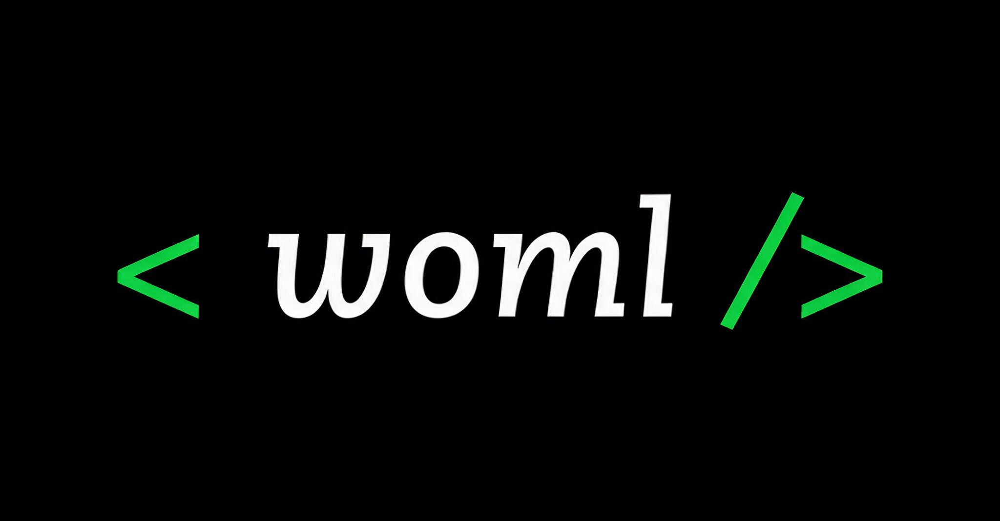
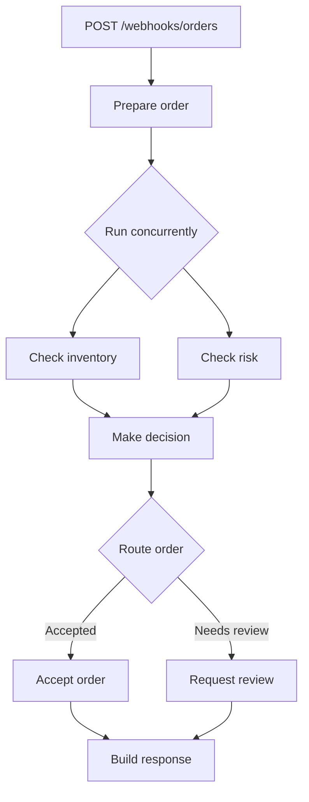
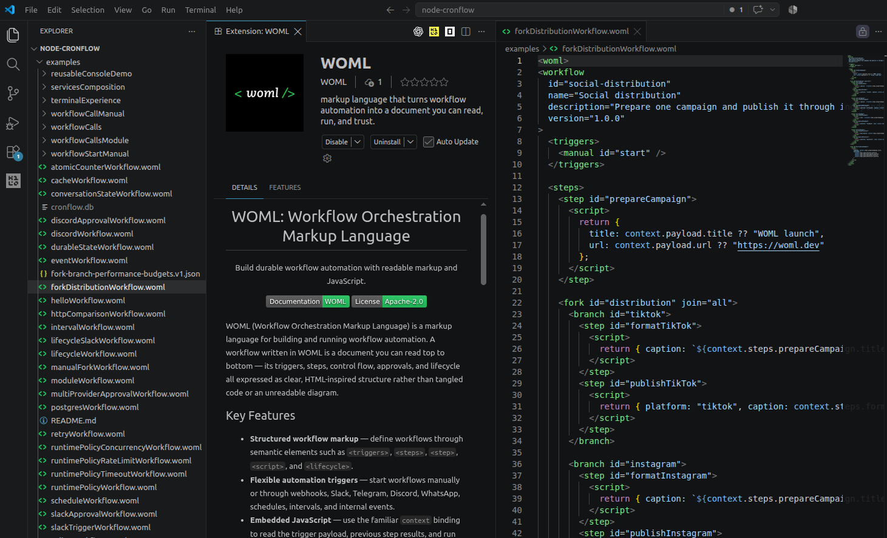

<div align="center">

# WOML: Workflow Orchestration Markup Language



### If you can read HTML, you can build workflows, apps, and AI agents with WOML.

**Readable markup for structure. JavaScript for logic. A durable runtime for execution.**

[](https://www.npmjs.com/package/woml-cli)
[](https://github.com/dali-benothmen/woml)
[](./LICENSE)
[]()

[Website](https://woml.org/) · [Documentation](https://woml.org/docs/) · [Examples](https://woml.org/examples/)

</div>

## What is WOML?

WOML is an open-source, code-first language and runtime for building automated workflows, backend applications, and AI agents. Describe the process in readable, HTML-inspired markup, use JavaScript for logic, and connect the APIs, services, databases, local tools, and infrastructure involved.

Each `.woml` file combines three parts:

- **Readable structure** — triggers, steps, branches, loops, parallel work, approvals, and policies remain visible as markup.
- **Real code** — inline JavaScript and imported JavaScript or TypeScript modules implement custom behavior without waiting for a built-in connector.
- **Managed execution** — the runtime handles attempts, retries, state, waits, workflow calls, recovery, and execution history.

The workflow source is the program, its readable architecture, and its execution policy. It can live in Git, move through pull requests and CI, and run locally or on infrastructure you control.

Start with one workflow for a local task or webhook. As the work grows, extract reusable modules, call or start other workflows, publish events, and operate the result as a coordinated system without changing its underlying model.

## What can you build?

| Build | Use WOML to |
| --- | --- |
| **Automated workflows** | Process orders, onboard customers, generate reports, review content, and coordinate human approvals. |
| **Backend applications** | Handle webhooks, expose workflow APIs, run scheduled jobs, and coordinate event-driven services. |
| **AI agents** | Connect models, tools, memory, specialist workflows, and human review in one durable process. |
| **Data pipelines** | Import, validate, transform, classify, and store data with explicit control flow and recovery. |
| **Infrastructure systems** | Run deployment checks, supervise local processes, coordinate infrastructure changes, and respond to incidents. |

## Why code-first WOML?

- **Read the whole process** — semantic markup keeps execution order, decisions, parallel work, and policies visible from top to bottom.
- **Use code where it belongs** — write JavaScript inline or import JavaScript and TypeScript modules for application-specific logic.
- **Integrate what your system needs** — call APIs, query databases, run approved local tools, and expose project-owned services without waiting for a connector catalog.
- **Grow through composition** — split large systems into reusable workflows that call each other, start background work, and communicate through events.
- **Keep operational history** — durable execution records attempts, decisions, waits, results, and failures so important work can be inspected and recovered.
- **Own the source and runtime** — review workflows in Git and run them on a developer machine, server, container, or infrastructure you control.

## How WOML works

1. **Describe the process** in a `.woml` file using triggers, steps, control flow, and runtime policies.
2. **Connect your tools** with inline JavaScript, imported modules, managed services, secrets, and reusable child workflows.
3. **Run and operate it** with the WOML runtime, which records durable state and provides inspection, cancellation, recovery, logs, and backups.

## Installation

WOML requires [Bun](https://bun.sh/) 1.3.14 or later. Install the global CLI with npm:

```bash
npm install --global woml-cli
```

Or install it with Bun or pnpm:

```bash
bun add --global woml-cli
pnpm add --global woml-cli
```

All three commands install the same `woml` executable:

```bash
woml --version
```

Native engines are selected automatically for supported macOS, Linux, and Windows systems. You do not need to install the platform packages or configure a database manually.

Linux packages require glibc 2.31 or newer.

## Quick Start: Build an Order Router

Create a file named `order-router.woml`:

```xml
<woml>
  <workflow
    id="order-router"
    name="Order Router"
    description="Check inventory and risk concurrently, then route the order."
    version="1.0.0"
  >
    <triggers>
      <webhook
        id="newOrder"
        path="/webhooks/orders"
        method="POST"
        auth="none"
      >
        <schema>
          {
            "type": "object",
            "required": ["orderId", "amount", "inStock", "riskScore"],
            "properties": {
              "orderId": { "type": "string" },
              "amount": { "type": "number" },
              "inStock": { "type": "boolean" },
              "riskScore": { "type": "number" }
            },
            "additionalProperties": false
          }
        </schema>
      </webhook>
    </triggers>

    <steps>
      <step
        id="prepareOrder"
        name="Prepare order"
        description="Normalize the order received by the webhook."
      >
        <script>
          return {
            orderId: context.payload.orderId,
            amount: context.payload.amount
          };
        </script>
      </step>

      <parallel
        id="orderChecks"
        name="Run order checks"
        description="Check inventory and risk at the same time."
        concurrency="2"
        on-error="wait-all"
      >
        <step
          id="inventoryCheck"
          name="Check inventory"
          description="Confirm that the requested item is available."
        >
          <script>
            return { available: context.payload.inStock };
          </script>
        </step>

        <step
          id="riskCheck"
          name="Check risk"
          description="Accept orders with a risk score below seventy."
        >
          <script>
            return {
              approved: context.payload.riskScore < 70,
              score: context.payload.riskScore
            };
          </script>
        </step>
      </parallel>

      <step
        id="canFulfill"
        name="Make decision"
        description="Combine the inventory and risk results."
      >
        <script>
          return {
            value:
              context.steps.inventoryCheck.available &&
              context.steps.riskCheck.approved
          };
        </script>
      </step>

      <choose
        id="orderRoute"
        name="Route order"
        description="Accept the order or send it for review."
      >
        <when test="{{context.steps.canFulfill.value}}">
          <step id="acceptOrder" name="Accept order">
            <script>
              return {
                status: "accepted",
                message: `Order ${context.steps.prepareOrder.orderId} is ready for fulfillment.`
              };
            </script>
          </step>
          <result value="{{context.steps.acceptOrder}}" />
        </when>

        <otherwise>
          <step id="reviewOrder" name="Request review">
            <script>
              return {
                status: "review",
                message: `Order ${context.steps.prepareOrder.orderId} needs review.`
              };
            </script>
          </step>
          <result value="{{context.steps.reviewOrder}}" />
        </otherwise>
      </choose>

      <step
        id="response"
        name="Build response"
        description="Publish one predictable result for the caller."
      >
        <script>
          return {
            orderId: context.steps.prepareOrder.orderId,
            amount: context.steps.prepareOrder.amount,
            ...context.steps.orderRoute
          };
        </script>
      </step>
    </steps>
  </workflow>
</woml>
```

Check it without starting the automation:

```bash
woml check order-router.woml
```

Then run it:

```bash
woml run order-router.woml
```

WOML keeps the automation active and prints its webhook URL together with a generated `curl` command. Trigger it from another terminal:

```bash
curl --request POST http://127.0.0.1:3000/webhooks/orders \
  --header 'content-type: application/json' \
  --data '{"orderId":"order-42","amount":240,"inStock":true,"riskScore":18}'
```

Use `auth="none"` only for local development. Configure authenticated webhooks before exposing an endpoint outside a trusted environment.

## How the Workflow Runs



## See the Result

WOML presents each run as an organized, colored terminal report. You will see output like this:

```text
RUN  run_8f21c4                                                Order Router

  ✓  Prepare order                                              3 ms
     Normalize the order received by the webhook.
     → { orderId: "order-42", amount: 240 }

  ✓  Check inventory                                            2 ms
     → { available: true }

  ✓  Check risk                                                 2 ms
     → { approved: true, score: 18 }

  ✓  Make decision                                              1 ms
     → { value: true }

  ✓  Accept order                                               1 ms
     → { status: "accepted", message: "Order order-42 is ready for fulfillment." }

  ✓  Build response                                             1 ms
     → { orderId: "order-42", amount: 240, status: "accepted" }

Completed in 10 ms · 6 succeeded
```

The exact run ID and timings will differ. Press <kbd>Ctrl</kbd>+<kbd>C</kbd> to stop the active workflow host.

## What You Just Built

- **`<webhook>`** validated an HTTP request and created a durable workflow run.
- **`context.payload`** exposed the validated trigger input to every script.
- **`<parallel>`** ran two independent checks concurrently and waited for both.
- **`context.steps.<id>`** made completed step results available downstream.
- **`<choose>`** selected one route and published a stable merged result.
- **The terminal experience** showed each step, result, duration, and final outcome.

## Explore what you can build

Every example below is checked against the current WOML compiler.

| Build                                                                | What it demonstrates                                                    | Run                                               |
| -------------------------------------------------------------------- | ----------------------------------------------------------------------- | ------------------------------------------------- |
| [Durable run counter](./examples/durableStateWorkflow.woml)          | State that survives future runs and process restarts                    | `woml run examples/durableStateWorkflow.woml`     |
| [Personalize a customer list](./examples/forEachWorkflow.woml)       | Durable per-item execution, bounded concurrency, and ordered results    | `woml run examples/forEachWorkflow.woml`          |
| [Social distribution](./examples/forkDistributionWorkflow.woml)      | Several independent multi-step branches with an explicit join           | `woml run examples/forkDistributionWorkflow.woml` |
| [Telegram approval](./examples/telegramApprovalWorkflow.woml)        | Human approval, interactive notification buttons, and durable waiting   | `woml run examples/telegramApprovalWorkflow.woml` |
| [Workflow composition](./examples/workflowCallManual/)               | One workflow calling another and using its returned result              | `woml run examples/workflowCallManual`            |
| [Durable external callback](./examples/durableWaits/ciCallback.woml) | A run that releases its worker and resumes from an idempotent CI signal | `woml run examples/durableWaits/ciCallback.woml`  |
| [Preview environment saga](./examples/compensationAndCleanup/previewEnvironment.woml) | Explicit rollback and mandatory cleanup for partial infrastructure success | `woml run examples/compensationAndCleanup/previewEnvironment.woml` |
| [Streamed Terraform release](./examples/streamingOutput/)           | Live process output, structured progress, review, locking, compensation, and replay | See the example runbook |
| [Local TypeScript module](./examples/moduleWorkflow.woml)            | Reusable project code exposed through `services.*`                      | `woml run examples/moduleWorkflow.woml`           |

Provider examples require their documented credentials. Browse the [complete example catalog](./examples/) for webhooks, schedules, intervals, internal events, databases, storage, cache, lifecycle, retries, communication providers, and production deployment.

## Build larger systems from reusable workflows

A WOML project can begin with one file and grow into a system of focused workflows and modules. Workflows can call another workflow and wait for its result, start independent work in the background, or publish events that other workflows consume.

Create a project with workflow discovery and operator-owned configuration already in place:

```bash
woml init my-project
cd my-project
woml check
woml test
```

The generated `workflow.json` keeps workflow discovery, policies, reviewers, and execution targets reviewable while secret values remain outside source control. The same project model supports local execution, durable artifacts and waits, rich approvals, infrastructure policies, streamed output, OpenTelemetry, and authenticated remote targets. Remote work never silently falls back to the coordinator.

Read the [project manifest reference](./docs/project-manifest.md), follow the [infrastructure-agent tutorial](./docs/infrastructure-agent-tutorial.md), or use the [operator runbook](./docs/combined-developer-experience-operator-runbook.md).

## Built for real execution

### Connect and extend

- **Embedded JavaScript** — use `context.payload`, `context.steps`, `attempt`, `services`, and explicitly referenced `secrets` inside scripts.
- **Project-owned modules** — import local JavaScript or TypeScript and expose reusable logic through `services.*`.
- **Managed capabilities** — use supervised HTTP, SQLite/PostgreSQL, storage, cache, state, events, workflow calls, and communication services.
- **Production triggers** — start work manually or from webhooks, schedules, intervals, internal events, Slack, Telegram, Discord, and WhatsApp.

### Structure complex work

- **Explicit control flow** — combine sequential steps, durable bounded item loops, parallel groups, choices, switches, and concurrent forks with explicit joins.
- **Reusable workflows** — call a workflow for a result, start background work, and coordinate independent components through events.
- **Human decisions** — pause durably for approval, preserve the decision, and continue through approved or rejected routes.
- **Runtime policies** — define concurrency, rate limits, queues, timeouts, retries, and lifecycle hooks beside the workflow they govern.

### Continue through failure

- **Durable execution** — preserve attempts, decisions, waits, results, failures, and operation identities across process restarts.
- **Retries and idempotency** — declare retry behavior while retaining stable attempt and operation identities.
- **Durable waits and signals** — suspend without holding a worker and resume the same run from timers or authenticated callbacks.
- **Locks, leases, and fencing** — serialize shared-resource work and reject stale owners with monotonic fencing tokens.
- **Compensation and cleanup** — correct proven partial success, always run cleanup, and stop for review when an external effect is ambiguous.

### Operate on your infrastructure

- **Inspection and recovery** — inspect activity, follow logs, cancel runs, retry verified-safe work, back up state, and prune old history.
- **Streaming output and progress** — follow supervised process output live, reconnect by cursor, and replay bounded redacted records.
- **Portable deployment** — run the same project locally or against authenticated remote targets without silent fallback.
- **Cross-platform runtime** — install one CLI that selects the appropriate native Rust engine automatically.

When an interrupted external effect has an uncertain outcome, WOML marks it **ambiguous** instead of retrying it automatically. Inspect the real system with `woml dispatch inspect`, then record an audited decision with `woml dispatch reconcile`.

## Common Commands

```bash
woml check workflows/                    # Parse, validate, and compile
woml run workflows/                      # Activate workflows in the foreground
woml run workflows/ --background         # Activate them in the background
woml inspect                             # Open the colored runtime inspector
woml list                                # List workflows and recent runs
woml get run_...                         # Inspect one run and its event history
woml cancel run_...                      # Cancel a pending or running workflow
woml recover run_... --retry action-id   # Resume a verified-safe corrective attempt
woml logs workflow-id --follow           # Follow live process output and progress
woml secrets set API_TOKEN               # Store a secret without printing it
woml backup backups/latest               # Back up the durable state store
woml prune --before 30d --dry-run        # Preview retention cleanup
```

See the [CLI reference](./docs/cli-reference.md) for all commands, flags, exit behavior, and machine-readable output.

## VS Code Experience

The [WOML extension](./woml-vscode/) gives `.woml` files HTML-style markup highlighting, embedded JavaScript syntax, highlighted runtime bindings such as `context` and `services`, reference-expression highlighting, snippets, and a dedicated file icon.

<div align="center">
  
</div>

The extension follows your existing VS Code theme instead of requiring a separate WOML color theme.

## Build WOML with AI coding agents

WOML is structured source code, so coding agents can create and change workflows in the same environment as the rest of your project. The **WOML Skill** teaches agents the language structure, runtime bindings, control-flow patterns, services, secrets, and validation workflow they need to produce real `.woml` files without inventing syntax.

```text
Use the WOML skill to build an order-processing workflow that starts from a
webhook, checks inventory and risk concurrently, and routes the result.
```

The generated workflow remains readable, reviewable in Git, and verifiable with `woml check` before it runs.

For Claude Code, install the complete skill in the current project:

```bash
mkdir -p .claude/skills/woml
curl -fsSL https://github.com/dali-benothmen/woml/releases/latest/download/woml-skill.tar.gz \
  | tar -xz -C .claude/skills/woml
```

For Codex and other clients that use the Agent Skills project convention:

```bash
mkdir -p .agents/skills
cp -R skills/woml .agents/skills/woml
```

**[View the WOML Skill and installation guide →](./skills/woml/)**

## Documentation and Examples

- [Getting started](./docs/getting-started.md)
- [Language reference](./docs/language-reference.md)
- [CLI reference](./docs/cli-reference.md)
- [Services and capabilities](./docs/woml-services.md)
- [Locks and leases](./docs/woml-locks-and-leases.md)
- [Compensation and cleanup](./docs/woml-compensation-and-cleanup.md)
- [Run local tools safely](./docs/woml-process.md)
- [Stream output and report progress](./docs/woml-streaming-output-and-progress.md)
- [Preserve files as Durable Artifacts](./docs/woml-durable-artifacts.md)
- [Modules](./docs/woml-modules.md)
- [Communication providers](./docs/woml-communication-providers.md)
- [Production deployment](./docs/woml-production-deployment.md)
- [Complete example catalog](./examples/)

## Support and Security

Use [GitHub Discussions](https://github.com/dali-benothmen/woml/discussions) for questions and [GitHub Issues](https://github.com/dali-benothmen/woml/issues) for reproducible bugs. Follow the [support guide](./SUPPORT.md) when sharing diagnostics, and report vulnerabilities privately according to the [security policy](./SECURITY.md).

## Contributing

Contributions are welcome, including bug reports, documentation improvements, tested examples, provider work, compiler changes, and runtime improvements. Read [CONTRIBUTING.md](./CONTRIBUTING.md) before opening a pull request.

## License

WOML is released under the [Apache License 2.0](./LICENSE).
