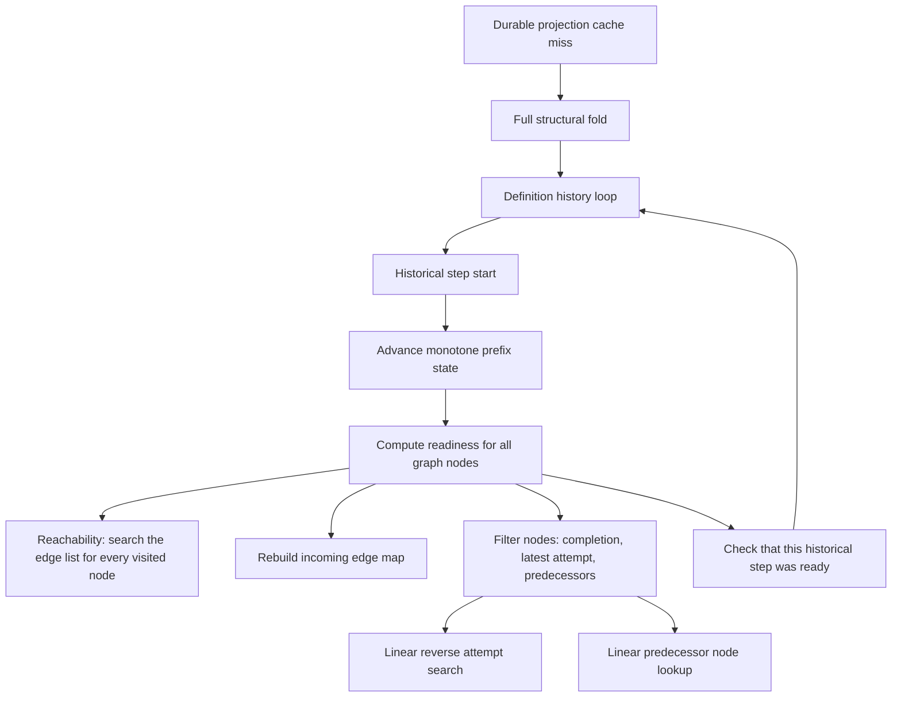

# WOML readiness performance investigation

Date: 2026-11-03. Branch: `perf/runtime-performance`.
Source checkpoint: `4188217` plus the receipted test-only investigation patch.
Repeated graph and attempt searches dominate the measured large-chain history
validation. At 1,024 nodes and 2,048 events, the complete checker used a median
**8.96 seconds of CPU**, while a separate structural fold used **8.41 ms**.
The historical readiness checks repeatedly traverse the graph and search lists;
the existing monotone prefix cursor is not repeatedly rebuilding all prefixes.

Three isolated optimized Linux captures completed. This investigation changes
only diagnostic tooling/tests, not production behavior or VSR0's acceptance gate.

Subsequent implementation: [indexed readiness queries](readiness-indexes.md).
The investigation and raw baseline below describe the pre-index checkpoint;
they are retained rather than rewritten as candidate results.

## Question

The [VSR baseline](validated-state-reuse-baseline.md) measured about 9.30 seconds
of CPU for a 2,048-event/1,024-node graph-stress cache miss, but only 8.54 ms for
a separate full fold. The broad definition/prefix span did not isolate its
inner work. Which checks account for the difference?

## Source-grounded path



Important source boundaries:

- [`engine/history.rs`](../core/woml-engine/src/engine/history.rs): every
  ordinary historical `StepAttemptStarted` requests the ready-node list at that
  event's timestamp and checks membership. This is an integrity check, not a
  redundant scheduler tick that can simply be deleted.
- [`history/prefix.rs`](../core/woml-engine/src/engine/history/prefix.rs): the
  existing cursor already applies each prefix event at most once per validator
  call. Its enclosing span includes the whole definition-check loop, not only
  cursor application. A long span does not prove expensive repeated folding.
- [`engine/readiness.rs`](../core/woml-engine/src/engine/readiness.rs):
  `active_node_ids` walks reachable nodes but searches the full edge vector at
  each visited node. Readiness then rebuilds an incoming map and filters the
  entire node vector.
- [`projection/run.rs`](../core/woml-engine/src/projection/run.rs):
  `latest_attempt` reverse-scans the attempts vector. On this successful chain,
  an unstarted future node has no match, so the whole prior-attempt list is read.
- [`model/queries.rs`](../core/woml-engine/src/model/queries.rs): `node(id)`
  searches the node vector. Predecessor checks repeat those searches.

The readiness function does **not** parse `.woml`, recompile scripts, execute
JavaScript, perform network I/O or call full model/schema validation on every
query. Definition loading does validate the model at its own boundary; that is
different from repeated graph/attempt searching inside readiness.

## Diagnostic protocol, declared before capture

- Keep production readiness and validation functions unchanged.
- Build a separately receipted optimized engine unit-test executable, using the
  existing explicit baseline builder. Do not compile while timing capture runs.
- Three independent serial processes, graph sizes 16, 64, 256 and 1,024 nodes.
- For a single readiness query, test zero, half and all-but-one completed nodes.
  Two warmups plus three measured repetitions per snapshot. Alternate original
  production query first and staged diagnostic copy first by sample index.
- Independently compare full active histories (32/128/512/2,048 events) with
  **fixed 17-event histories** across those same graph sizes. Thus graph width
  and history length are not silently treated as one variable.
- Each full-history timing is preceded by successful validation outside timing.
  Record one measured full-history sample per process, plus separate payload
  checks, structural folding and a prefix/readiness replay. The latter includes
  normal incremental `apply` and membership checks; it is not readiness-only.
- Use thread CPU and wall clocks. Summarize process medians for query samples;
  for history samples, report median/range over three processes. This is an
  exploratory diagnosis, not p95 evidence or an optimized-candidate comparison.
- Keep fixture identities, source/binary/compiler/host/harness identities and
  every raw sample/failure. Do not substitute this cohort for VSR0's frozen gate.

The test-only [Rust diagnostic](../core/woml-engine/src/engine/readiness/investigation.rs)
separates the **existing** reachability, incoming-map and filtering boundaries.
Its staged copy reuses production predicates and is checked against production
results/errors on recorded histories, wrong bindings and historical/future retry
timestamps. It does not maintain a new graph index, skip checks or alter caching.

Separate untimed counted copies report exact predicate/lookup inspections for
the successful **plain sequential chain only**. Counts are checked against the
production ready list and closed-form expectations. They are not CPU samples,
allocation counts, or instrumentation added to production.

### Run it

```bash
# Portable report checks and TypeScript; then serial native diagnostic tests:
bun run --cwd woml-cli test:readiness-investigation

# Explicit optimized build, separate from capture:
bun run --cwd woml-cli build:validated-state-reuse-baseline

# Use its printed receipt; this command never invokes Cargo:
bun run --cwd woml-cli capture:readiness-investigation --receipt /absolute/path/receipt.json
```

The runner retains reports under ignored
`woml-cli/.woml/performance/readiness-investigation-*`. It verifies the supplied
receipt/source/binary identities before and after each process, archives its own
harness and protocol, and requires at least 2 GiB available RAM/disk. A five-minute
process deadline preserves failures instead of hanging indefinitely. Resource
RSS stays raw/unverified as documented by the baseline; no byte-budget pass is
inferred from it.

## Why the work grows quickly

For a plain chain with `V` nodes and `E = V - 1` edges, all nodes are structurally
reachable even before the first step executes. Reachability is **not** readiness.
With `k` steps completed and no in-flight attempt, a single readiness query performs:

```text
Reachability edge inspections: V × (V - 1)
Unsuccessful latest-attempt inspections: (V - k) × k
Predecessor node inspections: sum(i, i = max(1, k) ... V - 1)
```

For a full active history containing one start for every node, sum over
`k = 0 ... V - 1`:

```text
Reachability edge inspections: V² × (V - 1)
Latest-attempt inspections:    V × (V² - 1) / 6
Predecessor node inspections:  V × (V² - 1) / 3
```

At 1,024 nodes, reachability alone therefore examines **1,072,693,248 edges**
across that one complete history validation. Several source-level costs scale
cubically for this chain cohort even though the monotone prefix replay itself
visits only a linear number of events. This is not a universal complexity claim
for every control-flow shape or a measured whole-workflow latency prediction.

## Results

All three processes passed fixture validation, query-equivalence checks and raw
report validation. CPU times below are milliseconds. Each history cell is the
median of three independent process samples, not a pooled p95.

| Graph nodes | Full active history events | Full history validation | Readiness and prefix replay | Separate structural fold | Validation with exactly 17 events |
| --- | ---: | ---: | ---: | ---: | ---: |
| 16 | 32 | 0.234 | 0.188 | 0.042 | 0.114 |
| 64 | 128 | 4.128 | 3.594 | 0.165 | 0.492 |
| 256 | 512 | 127.928 | 127.041 | 0.857 | 4.122 |
| 1,024 | 2,048 | 8,961.170 | 8,953.569 | 8.406 | 67.215 |

The 1,024-node full-validation CPU range was 8,910.484–9,080.259 ms. Its separate
payload-check pass was 5.315 ms median. The fixed-17-event range was
65.383–70.442 ms: graph size remains expensive even when the event count stays
small and only eight historical starts need checking.

These are separate warm measurements, not additive exclusive spans. The
readiness replay includes applying every event, including the suffix after the
validator's last requested prefix. A separate fold's returned projection is
destroyed after its timer. The comparison identifies the dominant work; it does
not supply an exact subtraction-based savings estimate.

### Cost of one readiness query

On the 1,024-node graph, the following are medians of the three process medians
(three measured samples within each process). Component times come from the
equivalent staged diagnostic copy; the whole-query time comes from the original
production function. Component-container teardown and timing overhead mean the
columns are not an exact partition of one production call.

| Completed nodes | Original query CPU | Reachable-node traversal | Incoming map construction | Node filtering |
| --- | ---: | ---: | ---: | ---: |
| 0 | 8.296 | 5.275 | 0.217 | 2.771 |
| 512 | 9.649 | 5.266 | 0.214 | 4.221 |
| 1,023 | 5.679 | 5.288 | 0.217 | 0.161 |

Reachable-node traversal remains expensive even when nearly all work has
finished: it still inspects 1,047,552 edges per query. At the halfway snapshot,
filtering also makes 262,144 attempt inspections and 392,960 predecessor-node
inspections. Near completion, those latter counts each fall to 1,023, matching
the much smaller filtering time. Incoming-map construction is a smaller cost in
these cases; replacing only that map would miss the main searches.

### Interpretation

The measured readiness replay nearly reproduces the full validator's cost, and
the component timings agree with the source-derived scan counts. The expensive
work is repeated discovery of graph reachability and repeated linear lookups,
not JavaScript execution, network calls, or deliberate workflow delays.

The cubic scan counts apply to this synthetic sequential-chain validation,
not every WOML program. A 16-node history remains sub-millisecond here. This
in-memory diagnosis is neither a clean installed workflow run nor a before/after
optimization comparison with the earlier SQLite cache-miss cohort. It does not
establish cross-platform timings, allocation/peak-memory behavior, or resolution
of startup-separation's separate retained-store/shutdown findings.

## Verification and provenance

- Two Rust diagnostic tests pass in development and in the final optimized
  executable. They check the staged query against recorded sequential,
  lifecycle, loop and combined histories, wrong bindings, and a completed
  in-memory retry history at historical/future timestamps. The frozen retry
  projection fixture remains unchanged; its missing prerequisite is supplied
  only in the independent test history.
- Four portable report tests and TypeScript checking pass; all 33 established
  modularization/source/CI guards pass. Protected production declarations and
  frozen fixture bytes are unchanged. Formatting and documentation checks pass.
- The fresh optimized executable also passes all 14 existing history/reference
  tests and 11 durable rollback/cache/opening boundary tests. All seven existing
  VSR report-contract tests pass alongside the four new report tests.
- Standard release test build (`opt-level = "z"`, LTO); rustc/Cargo 1.88.0,
  Bun 1.3.14; Linux x64, Intel Core i7-9750H. No builds or unrelated suites ran
  during accepted diagnostic captures.
- Raw build: `woml-cli/.woml/performance/validated-state-build-3f4YIS`.
  Raw capture: `woml-cli/.woml/performance/readiness-investigation-Py62J0`.
  Both are ignored generated data, retained separately from VSR0's raw cohort.
- Executable SHA-256:
  `814f4c4e5e11cc6c50cb1d693940d8c6b5daf955dd5b27441007c309629ea587`.
  Source-file manifest SHA-256:
  `eae98d70529efe57583fdca7beac61b881ec62c7c9946199d99f367ef0ab8478`.
  Tracked source-patch SHA-256:
  `8d4a41061ed0a7baff42462674226682d8c8c4a97651440e0dc708e9499828e0`.
  The source-file manifest additionally binds untracked Rust diagnostic files.
- Capture harness SHA-256:
  `a779205672926bb288017e4eca9caf972ddeb82152458bdf74875a7a55722279`.
  Full source/fixture hashes, exact build command, archived harness, protocol,
  resource metadata, logs and unfiltered samples remain in those directories.

## Recommended next design

Prioritize the graph-query preparation part of performance proposal 3 before
expecting a large gain from the narrow history-state reuse in VSR2/VSR3:

1. Prepare immutable node-ID and incoming/outgoing adjacency lookups for the
   exact validated definition. Reachability can then inspect outgoing edges
   directly rather than searching the full edge vector for every visited node.
2. Prepare latest-attempt lookup for the exact projection/prefix used by one
   readiness query. The current fold state's exact-attempt index is not the
   same thing as a latest-by-node query index. Begin with call-local rebuilding,
   not a new persistent/cross-request cache or speculative across-append proof.
3. Keep the full-scan implementation as the differential reference. After a
   separately approved index change, establish a new explicit baseline and
   reconsider whether duplicate-fold removal becomes worthwhile. Preserve the
   original VSR0 record rather than silently changing its target or source.

For this chain, such indexes can remove the named cubic scan terms, but a
history validator still makes many queries over evolving projections. This is
not a promised whole-runtime complexity or speedup. Targeted historical
membership checks or a fully incremental ready frontier need separate designs
if broader work remains justified after the smaller indexed-query change.

An index must not cache permission, branch selection, clock-dependent retry
eligibility, cancellation, locks or ownership. Historical checks must use their
own prefix and timestamp, not the latest run state. Branches, forks, loop scopes,
settlement, waits and immutable definition identity still need explicit tests.
Any memory/ownership trade-off needs measurement before shipping. Keep ready-list
source order, event-error precedence, commit/cache boundaries and fresh
authoritative reads. VSR0's allocation/native-control gates remain open; this
investigation does not close them or waive the frozen 10% target.
