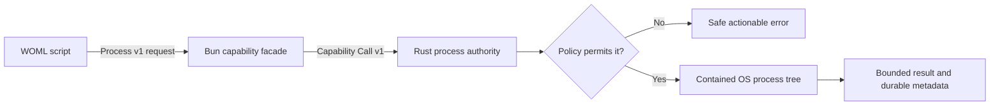

# Running Local Tools Safely with `services.process`

`services.process.run()` lets a WOML workflow invoke an operator-approved local
tool without turning the `<script>` worker into an unrestricted shell. It is
useful for project checks, build tools, infrastructure inspection, migration
utilities, and other commands that are part of a real automation.

Process execution is disabled by default. A workflow author requests an
executable by a stable alias such as `bun` or `kubectl`; the operator decides
which exact binary that alias represents, where it may run, which environment
names it may receive, and how much time and output it may consume.



## A first supervised command

```xml
<step id="check" name="Run project tests">
  <script>
    const result = await services.process.run({
      executable: "bun",
      args: ["test"],
      cwd: ".",
      timeout: "5m",
      output: {
        stdout: "capture",
        stderr: "capture",
        maxBytes: 65536
      }
    }, { name: "project-tests" });

    return {
      passed: result.exitCode === 0,
      output: result.stdout
    };
  </script>
</step>
```

There is no command string and no `shell` option. Every value in `args` is sent
to the executable as one literal argument. Text such as `; rm file`, `$HOME`,
or `$(command)` is data, not shell syntax.

Use a stable operation `name` whenever one step can issue more than one
effectful call. It becomes part of the durable operation identity; it is not an
OS process name.

## Request and result

`services.process.run(request, options?)` accepts:

| Field | Meaning | Default |
| --- | --- | --- |
| `executable` | Required policy alias, not a path or command string | none |
| `args` | Literal argument array | `[]` |
| `cwd` | Project-relative working directory | `.` |
| `env` | Explicit string environment values allowed by policy | `{}` |
| `timeout` | Milliseconds or a WOML duration such as `30s` | `30s` |
| `acceptExitCodes` | Exit codes treated as success | `[0]` |
| `output.stdout` | `capture` or `discard` | `capture` |
| `output.stderr` | `capture` or `discard` | `capture` |
| `output.maxBytes` | Combined bounded capture budget | `65536` |
| `stream` | Publish redacted stdout and stderr while the process runs | `false` |

The resolved request is constrained again by the operator policy. Authors
cannot raise the runtime's maximum timeout, output, concurrency, environment,
working-directory, or executable permissions.

The result contains:

```js
{
  exitCode,
  signal,
  stdout,
  stderr,
  stdoutBytes,
  stderrBytes,
  stdoutTruncated,
  stderrTruncated,
  durationMs,
  streamed,
  streamStartSequence,
  streamEndSequence,
  streamTruncated
}
```

When `stream` is `true`, WOML uses Process v2 and persists bounded operational
records while it continues draining both pipes. Capture remains independent:
you can stream a source and still discard it from the returned result. Process
v1 remains the exact default when streaming is omitted or false.

A non-accepted exit code throws `WomlServiceError`; it does not return a
successful result. Failure metadata contains safe status, duration, byte, and
truncation fields, but never command arguments, environment values, stdout, or
stderr.

## Grant a command for local foreground development

For a workflow you are actively reviewing, grant a short alias list:

```bash
woml check examples/process/project-checks.woml
woml test examples/process/project-checks.woml --allow-process bun
```

`--allow-process bun,git` resolves those names through the operator's current
`PATH`, pins their canonical executable identity for that runtime, permits only
the current project directory, inherits no ambient environment variables, and
works only in the foreground. It cannot be combined with `--background`.

On Windows, WOML also supplies `SystemRoot` from the Windows system-directory
API so native runtime, cryptographic, and networking initialization can work.
This is an OS bootstrap value, not an inherited application variable. `PATH`,
home directories, credentials, and other ambient variables still require
explicit operator approval.

This is intentionally a local convenience. A long-lived or background runtime
must use a reviewed policy file.

## Configure production authority

Copy [`process-policy.example.json`](../examples/process/process-policy.example.json)
and replace each executable path with the absolute path printed by the target
host:

```bash
which bun
which kubectl
```

Then start the runtime with the policy:

```bash
woml run workflows/ --process-policy ./process-policy.json --background
```

The policy freezes:

- foreground and background permission independently;
- one canonical filesystem path per executable alias;
- a canonical project root and allowed project-relative working directories;
- ambient environment names that may be inherited;
- explicit environment names that workflow source may supply; and
- maximum timeout, captured bytes, and concurrent processes.

The policy belongs to the operator, not to the workflow author. Do not let an
untrusted workflow modify its own policy or the approved executable files.
Run WOML as a dedicated least-privilege OS account and use a container or host
sandbox when the approved native program itself is not trusted.

## Environment and secrets

Process v1 starts from an empty environment. It inherits only names in the
policy's `environment.inherit` list and accepts explicit `env` keys only when
they appear in `environment.allow`.

```js
const result = await services.process.run({
  executable: "kubectl",
  args: ["rollout", "status", "deployment/api", "--namespace", "production"],
  env: { KUBECONFIG: secrets.KUBECONFIG_PATH },
  timeout: "2m"
}, { name: "inspect-api-rollout" });
```

Prefer passing a path to an owner-readable credential file instead of copying
credential contents into arguments or output. Arguments may be visible to
other privileged host tools. WOML redacts known resolved secret values from
captured output, but arbitrary programs can transform, split, encode, or write
secrets elsewhere. Redaction reduces accidental disclosure; it is not a data
loss prevention system.

Never return captured output containing credentials as a step result. Step
results become durable workflow context.

## Cancellation, timeout, and recovery

Rust creates a containment boundary around the whole command tree:

- Unix platforms use a dedicated process group;
- Windows uses a kill-on-close Job Object; and
- cancellation, timeout, worker loss, and handler drop close the complete
  supervised tree rather than only its first process.

Commands can produce external effects before they fail. A timeout,
cancellation, or host interruption is therefore marked ambiguous. WOML records
the operation start before execution, fails an unmatched start closed during
recovery, and never silently replays Process v1. Inspect the external system
before starting a reviewed new run.

Process v1 does not offer provider idempotency because arbitrary programs do
not share one idempotency protocol. If a tool has its own idempotency flag or
request key, pass `attempt.idempotencyKey` only through a reviewed argument or
environment contract supported by that tool.

## Output limits

Output is drained while the program runs so a full pipe cannot deadlock the
child. Captured text is bounded by both the request and policy. The result
reports total byte counts and whether each stream was truncated.

Streamed output has a separate operator-owned budget. Set optional
`limits.maxStreamBytes` in Process Policy v1 to a value from 1 byte through
256 MiB. Existing policies default to 16 MiB. Reaching the limit emits one
explicit truncation record and WOML keeps draining the process pipes, so noisy
children cannot deadlock.

Use `discard` for noisy output you do not need. Prefer a machine-readable mode
from the underlying tool (for example JSON) and parse only the small fields
required by later steps. Large files belong in durable artifacts or storage,
not workflow context.

## `Bun.spawn()` or `services.process.run()`?

| Need | Use |
| --- | --- |
| A durable workflow effect with policy, timeout, cancellation, recovery, and inspection | `services.process.run()` |
| A tiny child process wholly internal to trusted module implementation where durable supervision is intentionally unnecessary | raw Bun APIs, with caution |

Raw `Bun.spawn()` runs inside the JavaScript worker's authority. It does not
receive Process Policy v1 aliases, durable operation identity, Rust-owned tree
containment, bounded Process results, or fail-closed recovery. New workflow
steps should use `services.process.run()`.

To migrate an existing script:

1. replace the command string with `executable` plus a literal `args` array;
2. choose a stable operation `name`;
3. declare a bounded timeout and output policy;
4. remove ambient environment assumptions;
5. grant the executable locally with `--allow-process`;
6. create a reviewed Process Policy v1 document for production; and
7. test non-zero exit, timeout, cancellation, and truncated output behavior.

## Examples

- [Project checks](../examples/process/project-checks.woml) runs local type and
  test commands concurrently.
- [Kubernetes rollout check](../examples/process/kubernetes-rollout-check.woml)
  waits for rollout health without changing the deployment.
- [Release verification](../examples/process/release-verification.woml) builds
  and verifies an artifact without publishing it.

The capture-only wire contract remains in [Process v1](protocols/process-v1.md),
and the operational streaming contract is in
[Streaming Output and Progress v1](protocols/streaming-output-and-progress-v1.md).
The author/operator guide for `stream: true`, live following, truncation,
retention, and transcript artifacts is
[Streaming Output and Progress](woml-streaming-output-and-progress.md).
The adversarial boundary is in
[Process v1 Threat Model](process-v1-threat-model.md).
